<p align="center">
  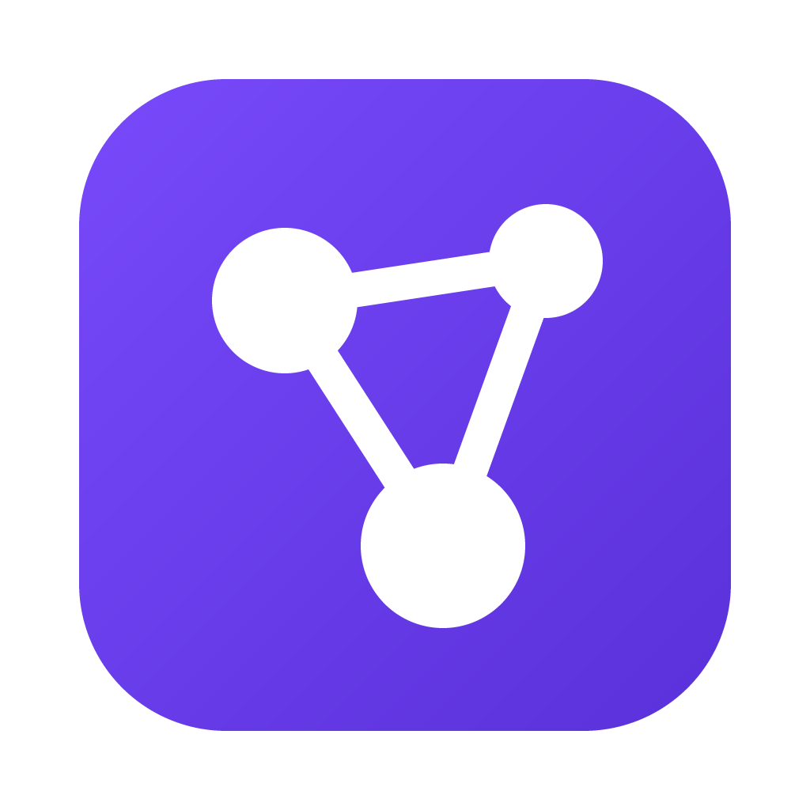
</p>

<h1 align="center">Synapse</h1>

<p align="center">
  <b>A calm, local-first Markdown workspace for connected notes on macOS.</b><br />
  Your notes stay plain files in folders you own. Your preferences follow you across every vault.
</p>

<p align="center">
  
  
  
  
  
</p>

<p align="center">
  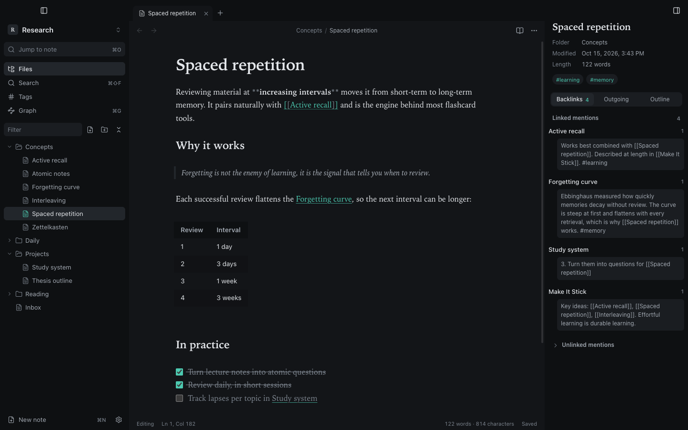
</p>

---

## Why Synapse

- **Plain files, no lock-in.** Every note is a `.md` file in a normal folder. Open the same folder in any editor, sync it however you like, back it up with Time Machine.
- **Preferences that stay put.** Theme, fonts, editor behaviour and hotkeys are global. Switching vaults never resets them, and any single preference can still be overridden for one vault.
- **Built for long writing sessions.** A serif page (New York) on a quiet graphite workspace, with comfortable line length and nothing moving while you type.
- **Links are the point.** Wiki links with autocomplete, backlinks with context, unlinked mentions, outgoing links, tags and a live graph. The single mint accent marks connections and nothing else.

## Screenshots

<table>
  <tr>
    <td width="50%"><br /><sub><b>Reading view</b>: rendered Markdown, clickable links, tags and task checkboxes.</sub></td>
    <td width="50%"><br /><sub><b>Graph</b>: every note and link, coloured by folder or tag. Drag, zoom, click to open.</sub></td>
  </tr>
  <tr>
    <td>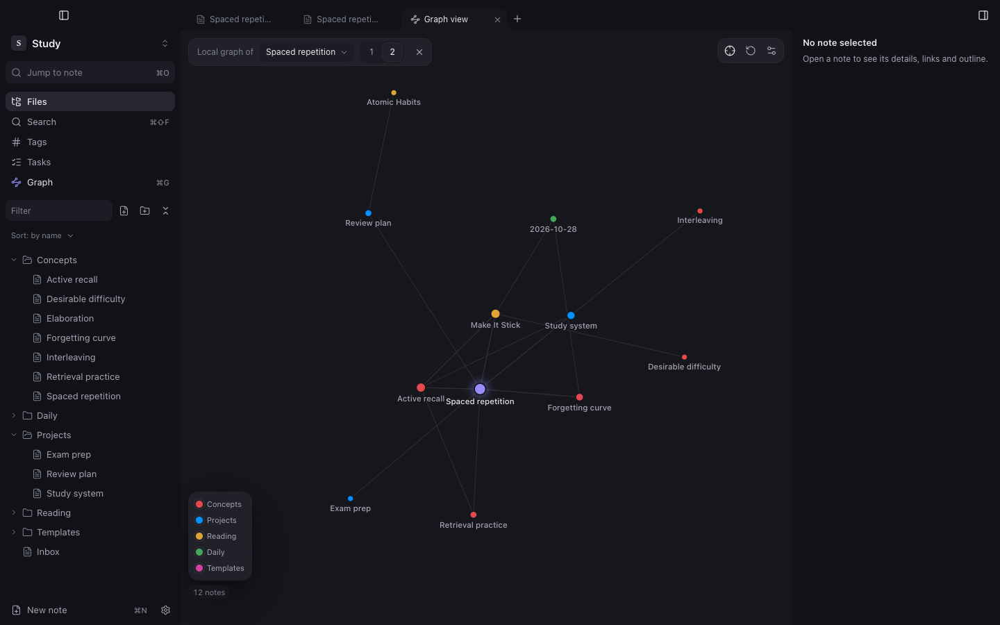<br /><sub><b>Local graph</b>: one note and what is one or two links away; saved views per vault.</sub></td>
    <td>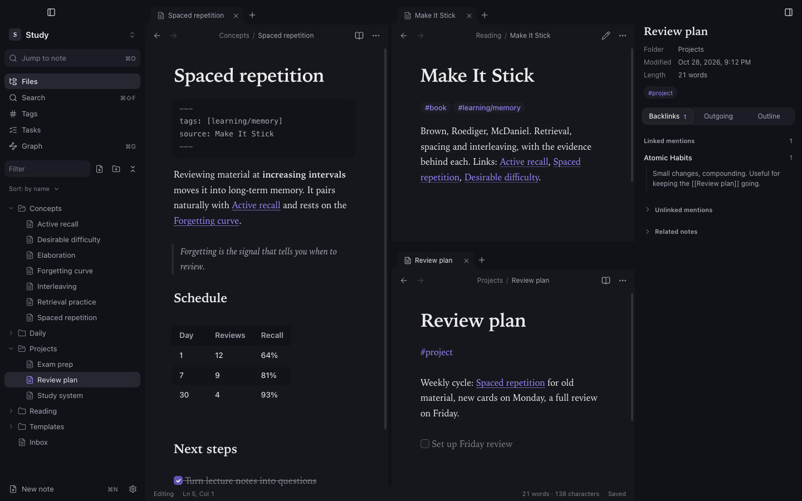<br /><sub><b>Panes</b> in any mix of rows and columns, pinned tabs, one window per vault.</sub></td>
  </tr>
  <tr>
    <td><br /><sub><b>Links to headings</b>: <code>[[Note#</code> lists the note's headings.</sub></td>
    <td>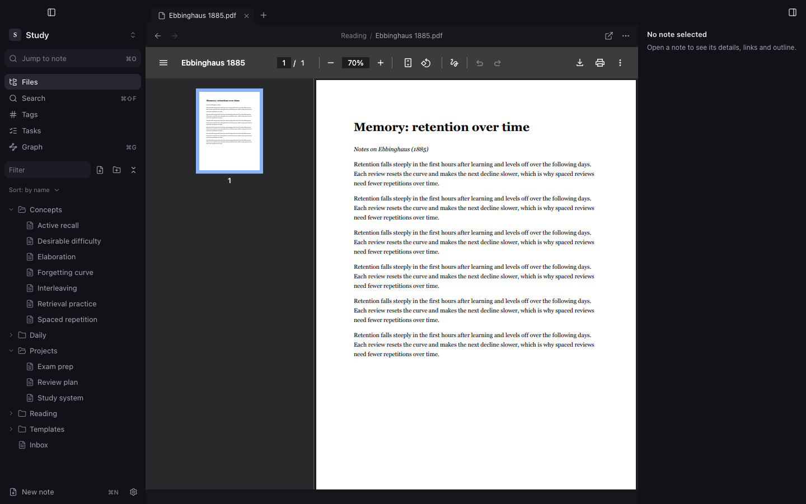<br /><sub><b>PDFs</b> open in a tab, with pages, zoom and search.</sub></td>
  </tr>
  <tr>
    <td>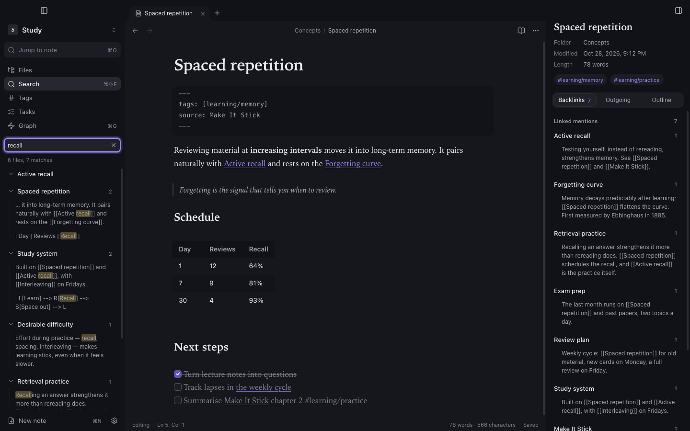<br /><sub><b>Search</b> with <code>"phrases"</code>, <code>-exclusions</code>, <code>tag:</code>, <code>path:</code> and <code>file:</code>.</sub></td>
    <td>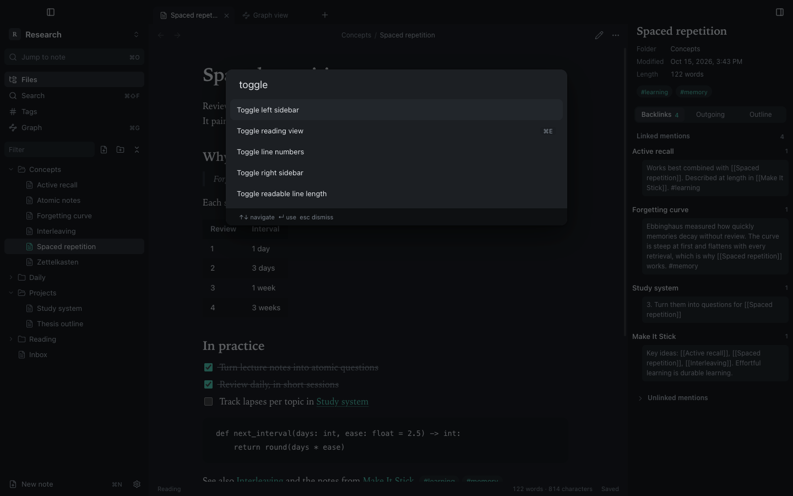<br /><sub><b>Command palette</b> (⌘P): every action, with its shortcut.</sub></td>
  </tr>
  <tr>
    <td>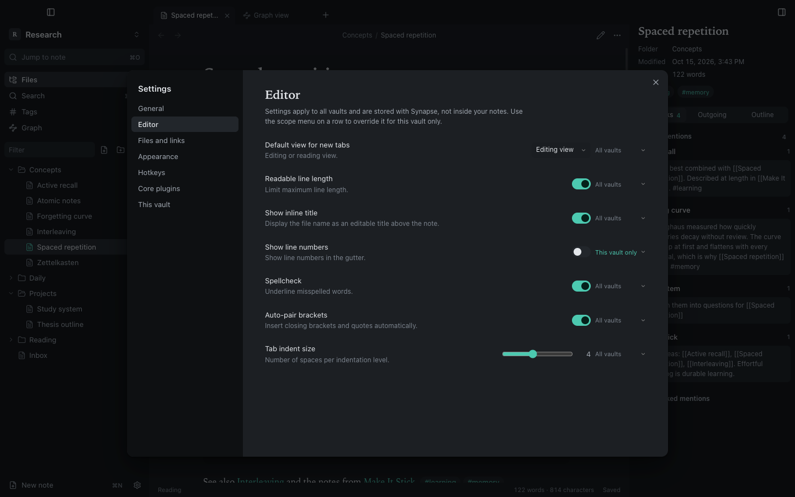<br /><sub><b>Settings</b>: each preference applies to <i>all vaults</i> or <i>this vault only</i>.</sub></td>
    <td>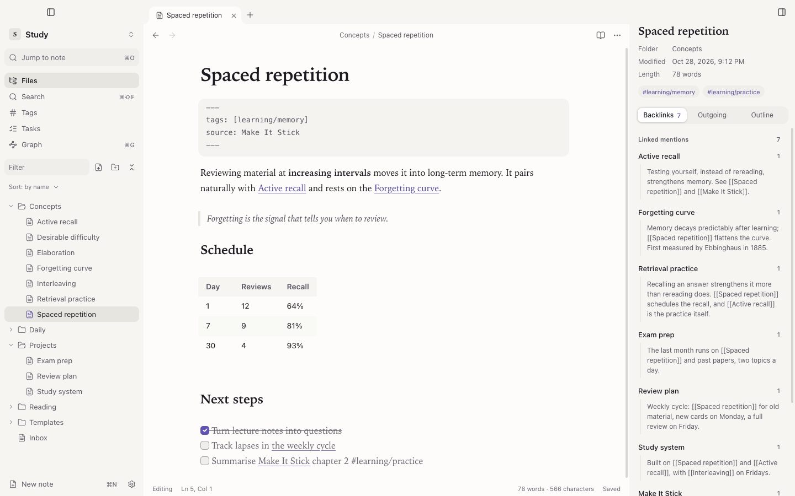<br /><sub><b>Light theme</b>, or follow macOS automatically.</sub></td>
  </tr>
  <tr>
    <td>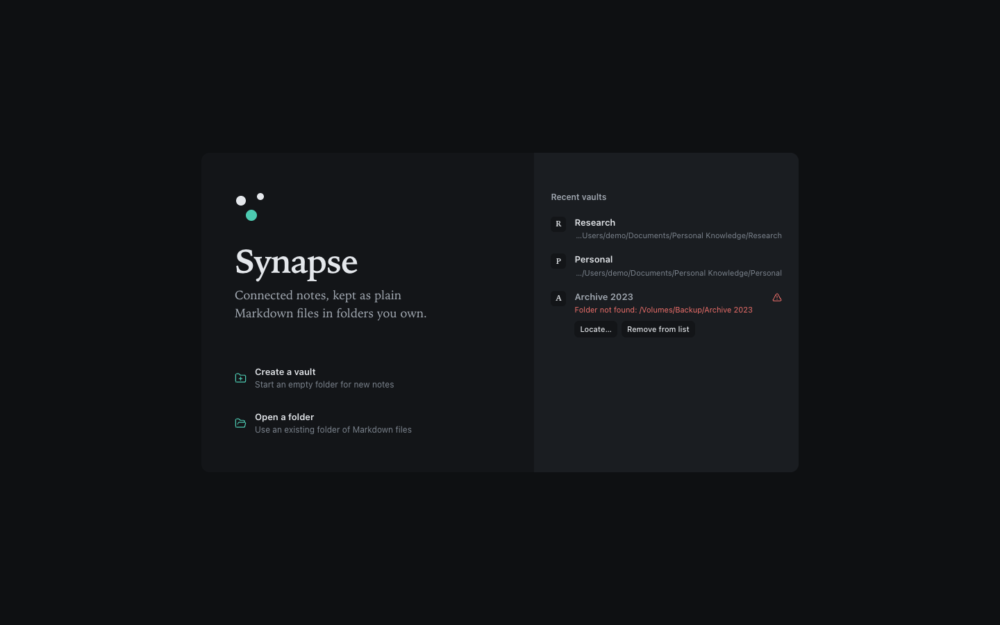<br /><sub><b>Vaults</b>: create, open, switch. Moved or missing folders are detected, never recreated empty.</sub></td>
    <td>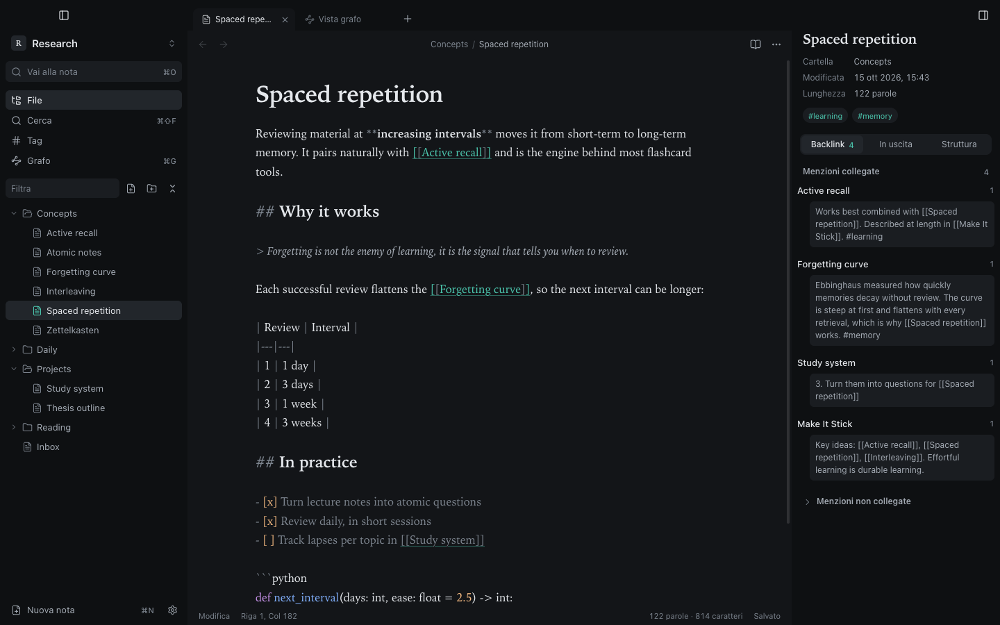<br /><sub><b>English and Italian</b>, switchable at any time.</sub></td>
  </tr>
</table>

## Features

| | |
|---|---|
| **Editor** | Live Preview: Markdown syntax hides itself except on the line you are editing; tables are edited as tables; LaTeX math (`$inline$`, `$$block$$`) renders with KaTeX. Built on CodeMirror 6, with `[[` link autocomplete (notes, headings with `#`, block ids with `^`, and *Create note* when nothing matches; never an empty popup), click a rendered link to open it (⌘-click anywhere in source), find & replace, formatting shortcuts, image paste and drop, folding of headings, lists and code blocks (arrow in the margin, ⌘⌥[ / ⌘⌥], *Fold all*), autosave |
| **Reading view** | Rendered Markdown with tables, syntax-highlighted code, Mermaid diagrams, math, quotes, Obsidian callouts (`> [!note]`, foldable with `+`/`-`), footnotes (`[^1]`), `%%comments%%` hidden when reading, embeds (`![[note]]`, `![[image.png]]`) and clickable task lists |
| **Tasks** | Every `- [ ]` checklist item in the vault in one list (open, done or all), grouped by note; tick it there or jump to its line |
| **Start page** | A new tab shows today's note, pinned notes, recently opened and recently modified notes |
| **Export** | A note to standalone HTML or to PDF, with images, code highlighting and diagrams included; the whole vault to a folder of linked HTML pages |
| **Daily notes & templates** | Open today's note from the command palette or **File → Open Today's Note**, step to the previous or next day, and create or fill notes from built-in or your own templates |
| **Knowledge** | Backlinks with context, unlinked mentions, related notes with the reason they are related, outgoing and unresolved links, outline, tags (inline and front-matter), graph view with filters (`path:`, `tag:`, `file:`, words), unlinked-only view and ⇧-click highlighting of a note's connections, a local graph around the open note (depth 1 or 2), node colours by folder or first tag with a legend, and saved graph views per vault |
| **Navigation** | Hold ⌘ over a `[[link]]` (editor or reading view) to preview the linked note in a floating card; quick switcher (⌘O), command palette (⌘P), tabs, split panes nested in any mix of rows and columns, per-tab back/forward, recent notes, workspace restored per vault; several vaults side by side in separate windows (*File → New Window* ⌘⇧N, or *Open in new window* on a vault in the vault manager). A vault opens in one window at a time, and every vault window comes back at the next launch. `.md` files open from Finder (double-click, *Open With*, drop on the Dock icon) in the window of their vault. A single click in the file tree opens a *preview tab* (italic title, reused by the next click); double-click, double-clicking the tab, or typing in it keeps the tab |
| **Files** | File tree with drag-and-drop moves, rename with automatic link updates, delete to the macOS Trash, reveal in Finder; a report of missing and possibly unused attachments; PDFs open in a read-only tab (or in your default app); opening a new folder first shows a read-only summary (links, attachments, unsupported syntax) |
| **macOS** | `synapse://` links: `synapse://open?vault=Name&file=Folder/Note`, `synapse://new?vault=Name&name=Title&text=…` (never overwrites), `synapse://capture`. Quick capture: a system-wide shortcut (⌘⇧Space by default, *Settings → General*) opens a small window whose text is appended to today's daily note or to `Inbox.md` in the vault used last. Menu bar icon with the recent notes of the open vaults, *New Note* and *Quick Capture* |
| **Safety** | Atomic writes, conflict detection when a file changes on disk, local version history with restore, path checks that keep every operation inside the vault, sandboxed renderer |
| **Personalisation** | Light / dark / system theme, accent colour, rebindable hotkeys, core features that can be switched off globally or per vault; note and code fonts are picked from the families installed on your Mac, with a live preview, and you can add your own font files (.ttf, .otf, .woff, .woff2), which Synapse stores in its own app-data folder, never in a vault |
| **Languages** | English and Italian, following macOS by default |

## Install

1. Download the latest **`Synapse-<version>-arm64.dmg`** (Apple silicon) or **`Synapse-<version>-x64.dmg`** (Intel) from [Releases](https://github.com/Sero3105/Synapse/releases).
2. Open it and drag **Synapse** onto **Applications**.
3. The first time you open Synapse, macOS warns that it cannot verify the app, because builds are not notarized yet. Open **System Settings → Privacy & Security** and click **Open Anyway**. You only need to do this once.

From 1.5.0 on, updates install from inside the app: when a new version is out, click **Update and restart**. Synapse downloads it from GitHub Releases, checks that it is signed with the project's release key, replaces itself in Applications and reopens. Synapse must be in the Applications folder for this.

Requirements: macOS 13 Ventura or later, on Apple silicon or Intel.

### Build from source

```sh
git clone https://github.com/Sero3105/Synapse.git
cd Synapse
npm install
npm run package       # builds release/mac-arm64/Synapse.app
npm run install:app   # copies it to /Applications/Synapse.app
```

Requirements for building: Node.js 22 or newer.

`install:app` only replaces an existing Synapse build (bundle id `com.synapse.notes`), refuses while the app is running, and never touches your notes or preferences. The app is ad-hoc signed, not notarized.

**Update:** pull, then run the two commands again.
**Uninstall:** delete `/Applications/Synapse.app`. You can also delete `~/Library/Application Support/Synapse` to remove preferences. Notes are never stored in either place.

## Keyboard shortcuts

| Action | Shortcut | Action | Shortcut |
|---|---|---|---|
| Command palette | ⌘P | New note | ⌘N |
| Jump to note | ⌘O | New tab / close tab | ⌘T / ⌘W |
| Search all notes | ⇧⌘F | Reopen closed tab | ⇧⌘T |
| Find in note | ⌘F | Next / previous tab | ⌃⇥ / ⌃⇧⇥ |
| Reading / editing view | ⌘E | Back / forward | ⌥⌘← / ⌥⌘→ |
| Graph | ⌘G | Bold / italic / link | ⌘B / ⌘I / ⌘K |
| Settings | ⌘, | Toggle checkbox | ⌘L |
| Close vault | ⇧⌘W | | |

Every shortcut can be changed in **Settings → Hotkeys**.

## How settings work

| What | Where it lives | Scope |
|---|---|---|
| Theme, fonts, editor behaviour, language, hotkeys, sidebar layout | `~/Library/Application Support/Synapse/settings.json` | All vaults |
| Recent vaults and window sizes (one per vault) | `~/Library/Application Support/Synapse/` | App |
| Per-vault overrides, graph settings and saved graph views, attachment folder | `<vault>/.synapse/settings.json` | One vault |
| Open tabs, panes and recent notes | `<vault>/.synapse/workspace.json` | One vault |
| Version history (earlier copies of notes) | `~/Library/Application Support/Synapse/history/<vault id>/` | One vault |

Precedence is **defaults → global → vault override**. Changing a preference while a vault overrides it changes only that vault. Removing the override falls back to the global value. Synapse writes nothing else into your vault, and it never modifies an existing `.obsidian/` folder.

## Daily notes, templates and version history

**Daily notes.** *Daily notes: Open today's note* (command palette, or **File → Open Today's Note**) opens `YYYY-MM-DD.md`. If a note with that name exists anywhere in the vault, it is opened; otherwise it is created next to your most recent daily note, or at the vault root for the first one. Existing notes are never overwritten. *Open previous/next daily note* step through the daily notes that exist. Give any of these commands a shortcut in **Settings → Hotkeys**.

**Templates.** *Templates: Insert template* inserts a template at the cursor (one undoable edit; nothing is replaced). *Templates: Create new note from template* (also **File → New Note from Template…**) asks for a name and refuses names that already exist. Built-in templates: general, study, meeting and project notes. Your own templates are the notes in the vault folder `Templates/`, and `Templates/Daily note.md` (if present) is used for new daily notes. Placeholders: `{{title}}`, `{{date}}` (YYYY-MM-DD) and `{{time}}` (HH:mm).

**Version history.** Before Synapse overwrites a note, it keeps a copy of the text on disk, at most once every 10 minutes per note while you type, and always when the text on disk was changed outside Synapse (including while Synapse was closed) or is replaced after a conflict. Identical copies are skipped, and the newest 50 per note are kept. Open it from a note's context menu, the tab menu, the **⋯** menu or *Show version history*. Pick a version, read it, and **Restore** after a confirmation. The text you replace becomes a version too, so a restore can be undone. A restore is refused if the note changed on disk since it was loaded.

History lives in `~/Library/Application Support/Synapse/history/<vault id>/`, outside the vault, so it is not synced and does not travel with the vault folder. It follows renames made in Synapse. It is not deleted with the note, and a note deleted or renamed outside Synapse keeps its history under the old name. Changes made by other apps are only captured when Synapse next saves over them.

## Related notes, tasks, attachments, export and import

- **Related notes** (Backlinks panel, collapsed by default): notes not yet linked to this one, scored by shared tags (+3 each), notes both link to or are linked from (+2), shared title and heading words (+2) and distinctive shared words (+1). Each suggestion says why. *Insert link at cursor* writes `[[…]]` only when you choose it; *Dismiss* hides a suggestion for this vault. Everything is computed locally from the in-memory index.
- **Graph**: in the settings panel, filter with the search syntax, show only unlinked notes, ⇧-click a node to highlight its connections (Esc clears), and *Reset view*. The crosshair button (or *Graph view: Toggle local graph*) shows only the open note and the notes 1 or 2 links away; it follows the note you open. *Colour by* gives the eight largest top-level folders, or first tags, a colour each, listed in a legend. *Save view…* keeps the mode, depth, centre note, filters and options under a name, to recall, rename or delete later. Vaults above 1,000 visible notes use a Barnes–Hut layout (`npm run bench:graph` measures it).
- **Tasks** (navigator): ticking a task changes only that line. If the note changed since the list was built, nothing is written and Synapse tells you; edits still go through the normal autosave conflict check.
- **Attachments** (*Attachments: Show missing and unused attachments*): a report only, nothing is deleted. A file is "possibly unused" only when no note links to or embeds it and its name appears in no note at all. References from other apps, CSS or scripts are not detected.
- **Export** (*Export to HTML* / *Export to PDF*): a standalone file with images embedded and no scripts. HTML follows the app theme; PDFs are always light, for paper. The macOS save dialog asks before replacing an existing file. Internal links become plain text. Web images are fetched from the web; a PDF export waits at most 15 seconds for them and leaves out any that have not loaded.
- **Export vault** (*Export vault to HTML*): pick a folder; Synapse creates a new `<vault> (HTML)` folder inside it (never replacing an earlier one) with one page per note in the same folders as the vault, an `index.html` listing every note, and a link back to it on each page. Links between notes, including `[[Note#Heading]]`, become links between the pages, so the site can be read in any browser and sent to someone. Links to missing notes or to attachments other than images stay plain text.
- **Import**: Synapse opens any Markdown folder in place and never converts it. When you open a folder that is not yet a Synapse vault, a read-only summary appears first; *Cancel* leaves the folder untouched, and *Open vault* only adds the `.synapse/` folder.
- **Start page** pins (file context menu → *Pin to start page*), recent notes and dismissed suggestions are stored per vault in `.synapse/workspace.json`.

**Semantic search (evaluated, not added).** Meaning-based search would need a local embedding model (roughly 100 MB or more), an index kept in sync with every edit, and background work while you type. For personal notes, the existing exact search plus related notes covers most needs, so Synapse does not include it.

## Languages

The interface is available in **English** and **Italiano**. By default it follows the macOS language order; change it in **Settings → General → Language**. The native menu bar and dialogs switch too.

To add a language, add a dictionary to `src/shared/i18n.ts`. The type checker rejects a dictionary that is missing a key, and a unit test checks that placeholders match.

## Privacy

Everything stays on your Mac: no account, no telemetry, no cloud sync. Synapse goes online only in two cases. At launch, and once a day while it stays open, it asks GitHub Releases whether a newer version exists (no personal data is sent; turn it off in **Settings → General → Check for updates**), and downloads the update only when you click **Update and restart**. And when a note asks it to, for example to load a remote image embedded with an `https://` link, or when you click a web link, which opens in your browser.

## Development

```sh
npm run dev         # Vite + Electron with hot reload
npm run typecheck   # tsc --noEmit
npm test            # unit and integration tests (vitest)
npm run test:e2e    # builds, then drives the real Electron app with Playwright
```

```
src/
  main/       Electron main process: window, menu, IPC, vault filesystem, settings storage
  preload/    the narrow, allow-listed bridge exposed to the UI
  renderer/   React UI: editor, reading view, sidebars, graph, modals, settings
  shared/     settings schema and precedence, Markdown/link index and search, i18n
test/         vitest suites (settings, vault safety, links and search, i18n)
e2e/          Playwright suites against the packaged app
docs/         architecture, design system, testing notes
```

End-to-end tests run against isolated temporary vaults and app-data folders, with hidden windows that never take focus. Release builds turn off Electron's `--inspect` fuse, so to run the suite against a packaged app, build one with it on:

```sh
npm run build && npm run notices
npx electron-builder --mac --dir -c.electronFuses.enableNodeCliInspectArguments=true
SYNAPSE_APP=release/mac-arm64/Synapse.app/Contents/MacOS/Synapse npx playwright test
```

## Documentation

- [Architecture](docs/architecture.md) and [settings model](docs/settings-architecture.md)
- [Design system](docs/design-system.md)
- [Feature matrix and known limitations](docs/feature-matrix.md)
- [Testing](docs/testing.md) and [UI testing](docs/ui-testing.md)

## Known limitations

- Raw HTML in notes is not rendered, for security.
- Obsidian community plugins are not supported.
- Task due dates and semantic search are not available.
- Opening a large new folder reads every note twice: once for the read-only preview, once when it opens.
- If the Mac crashes during a save, the note keeps its previous text and the new text may remain next to it as `Note.md.<number>.<number>.tmp`. Synapse never deletes it; open it in another editor to recover the text, then delete it.
- If the vault folder is moved or deleted while it is open, saving stops with a message and keeps your text in the editor; Synapse never recreates the folder. Saving resumes when the folder is back at the same place.
- The build is not notarized. In-app updates are verified with the project's own ed25519 release key, not Apple's signing. The Intel build is not yet tested on Intel hardware.
