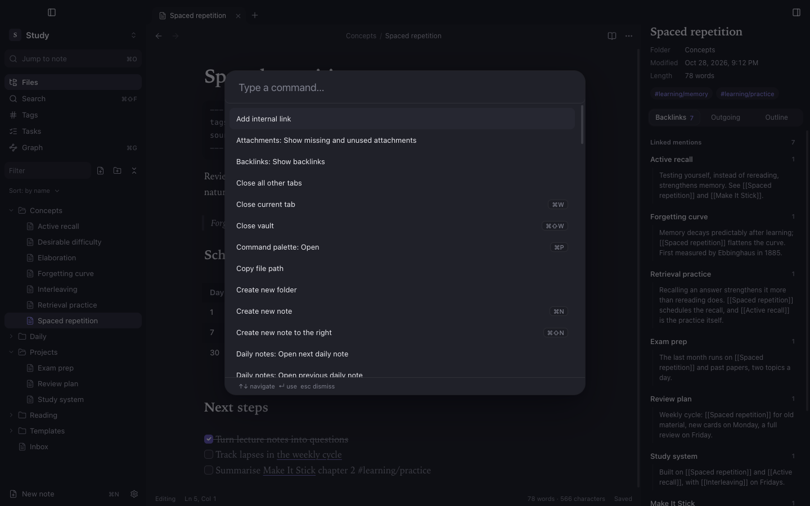

Hotkeys are global: they are the same in every vault.

## Defaults

| Action | Shortcut | Action | Shortcut |
|---|---|---|---|
| Command palette | <kbd>⌘P</kbd> | New note | <kbd>⌘N</kbd> |
| Jump to note | <kbd>⌘O</kbd> | New tab / close tab | <kbd>⌘T</kbd> / <kbd>⌘W</kbd> |
| Search all notes | <kbd>⇧⌘F</kbd> | Reopen closed tab | <kbd>⇧⌘T</kbd> |
| Find in note | <kbd>⌘F</kbd> | Next / previous tab | <kbd>⌃⇥</kbd> / <kbd>⌃⇧⇥</kbd> |
| Reading / editing view | <kbd>⌘E</kbd> | Back / forward | <kbd>⌥⌘←</kbd> / <kbd>⌥⌘→</kbd> |
| Graph | <kbd>⌘G</kbd> | Bold / italic / link | <kbd>⌘B</kbd> / <kbd>⌘I</kbd> / <kbd>⌘K</kbd> |
| Settings | <kbd>⌘,</kbd> | Toggle checkbox | <kbd>⌘L</kbd> |
| Rename file | <kbd>F2</kbd> | Close vault | <kbd>⇧⌘W</kbd> |
| Fold / unfold section | <kbd>⌥⌘[</kbd> / <kbd>⌥⌘]</kbd> | New window | <kbd>⇧⌘N</kbd> |

## Changing a hotkey

1. Open **Settings → Hotkeys** and filter for the command.
2. Click the add button on its row and press the new combination.
3. If it is already used, the row shows which commands it conflicts with.

Remove a binding with its remove button, or use **Restore default** on the row.
