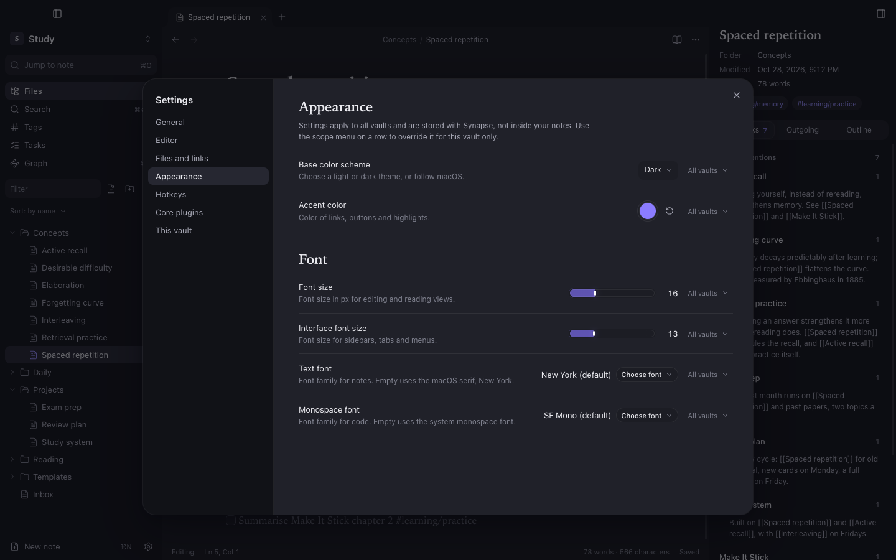

Open Settings with <kbd>⌘,</kbd>.

## Global first, vault when you choose

Synapse keeps your preferences **global**: theme, fonts, editor behaviour, language, hotkeys and the dock layout apply to every vault, and switching vaults never resets them.

Any preference can still be **overridden for one vault**. Each row has a scope menu, **All vaults** or **This vault only**. Precedence is:

> defaults → global → vault override

Changing a preference while a vault overrides it changes only that vault. Removing the override falls back to the global value. **Settings → This vault** lists the overridden preferences and has **Use global preferences** to clear them all.

| What | Where it lives | Scope |
|---|---|---|
| Theme, fonts, editor behaviour, language, hotkeys, dock layout | `~/Library/Application Support/Synapse/settings.json` | All vaults |
| Recent vaults and window size per vault | `~/Library/Application Support/Synapse/` | App |
| Vault overrides, graph settings and saved views, attachment folder | `<vault>/.synapse/settings.json` | One vault |
| Open tabs, panes and recent notes | `<vault>/.synapse/workspace.json` | One vault |

## Sections

**General**: language, current vault, manage or close vaults, where settings are stored.

**Editor**: default view for new tabs, Live Preview, readable line length, inline title, line numbers, spellcheck, auto-pair brackets, tab indent size.

**Files and links**: confirm file deletion, default location for new notes, automatically update internal links.

**Appearance**: base colour scheme (light, dark or adapt to macOS), accent colour, text font, monospace font, font size and interface font size. An empty text font uses the macOS serif, New York. From 1.4.0 the font picker lists installed families grouped with live previews, and **Add fonts…** adds your own font files; a font that cannot be loaded is marked instead of failing silently.

**Hotkeys**: see [Hotkeys](/docs/configuration/hotkeys/).

**Core plugins**: see below.

**This vault**: the attachment folder, the overridden preferences and the plugin set for this vault.

## Core plugins

Built-in features can be turned off: Search, Backlinks, Outgoing links, Graph view, Tags view, Outline and Word count. By default the choice applies to all vaults; turn on **Plugin set for this vault** to keep a separate selection in one vault.

Third-party (community) plugins are not supported.

## Language

The interface is available in English and Italiano. By default it follows the macOS language order; change it in **Settings → General → Language**. The menu bar and dialogs switch too.
