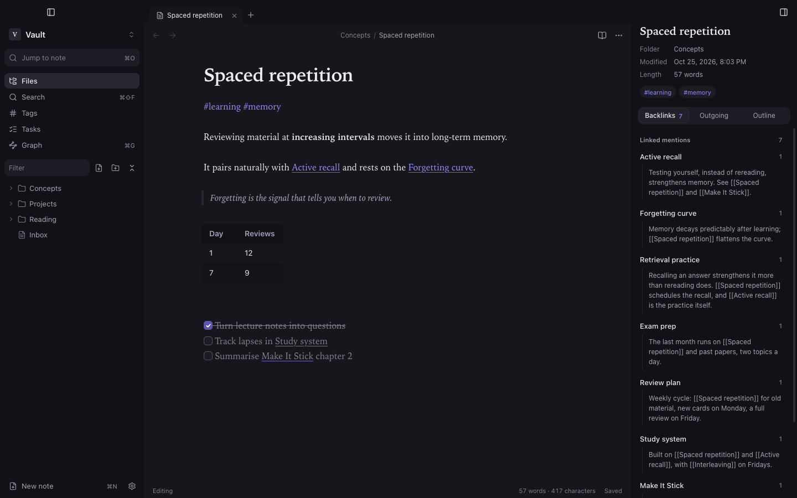

The editor is built on CodeMirror 6 and edits the Markdown file directly. Nothing is stored in another format.

## Live Preview

With **Live Preview** on (Settings → Editor, on by default), Markdown syntax hides itself except on the line you are editing: headings show without `#`, bold without `**`, links show only their text, task markers become checkboxes. Move the cursor onto a line to see and edit its source. The file on disk always keeps the full Markdown.

Turn Live Preview off to see the raw Markdown everywhere.

## Tables

Outside the cursor, Markdown tables render as a grid you can type into directly. Each cell edit rewrites the Markdown table, aligned and undoable.

- **Enter** moves to the cell below; **Escape** returns to the text.
- **+ Row** adds a row at the end.
- **Edit as Markdown** puts the cursor in the table source.

## Math

LaTeX math renders with KaTeX, in Live Preview and in the reading view:

```md
Inline $E = mc^2$ in a sentence.

$$
\int_0^1 x\,dx
$$
```

Invalid TeX shows as red source text instead of breaking the note. Prices such as `$5 and $10` stay plain text.

## Links while you type

Type `[[` to get suggestions from the vault, ranked as you type. Choosing one inserts the shortest unambiguous link text. See [links and backlinks](/docs/guides/links/).

## Formatting shortcuts

| Action | Shortcut |
|---|---|
| Bold / italic / link | <kbd>⌘B</kbd> / <kbd>⌘I</kbd> / <kbd>⌘K</kbd> |
| Toggle checkbox | <kbd>⌘L</kbd> |
| Find in note | <kbd>⌘F</kbd> |
| Undo / redo | <kbd>⌘Z</kbd> / <kbd>⇧⌘Z</kbd> |

All shortcuts can be changed in [Hotkeys](/docs/configuration/hotkeys/).

## Images and attachments

Paste or drop a file into the editor. Synapse saves it to the vault's attachment folder and inserts `![[file name]]`. The attachment folder is a vault setting: the vault root, a folder of your choice, or `./` for the same folder as the note.

## Saving

Notes autosave shortly after you stop typing, and also when you close a tab, switch vault or quit. Writes are atomic: a crash cannot leave a half-written file. If the file changed on disk while you had unsaved edits, Synapse shows a conflict banner instead of overwriting; see [Troubleshooting](/docs/troubleshooting/#a-conflict-banner-appears).

## Export and version history (1.3.1, not released yet)

**Export to HTML** / **Export to PDF** (command palette) writes a standalone file: images embedded, code highlighted, diagrams included, no scripts. HTML follows the app theme; PDFs are always light, for paper. The save dialog asks before replacing an existing file. Internal links become plain text. Web images are fetched from the web; a PDF export waits at most 15 seconds for them and leaves out any that have not loaded.

**Show version history** (a note's context menu, the tab menu, the **⋯** menu or the command palette) lists earlier copies of the note. Synapse keeps a copy before it overwrites a note — at most once every 10 minutes per note while you type, and always when the text on disk changed outside Synapse. The newest 50 per note are kept, outside the vault in `~/Library/Application Support/Synapse/history/`, so history is not synced and does not travel with the vault folder. Pick a version, read it, and **Restore** after a confirmation; the text you replace becomes a version too, so a restore can be undone.
