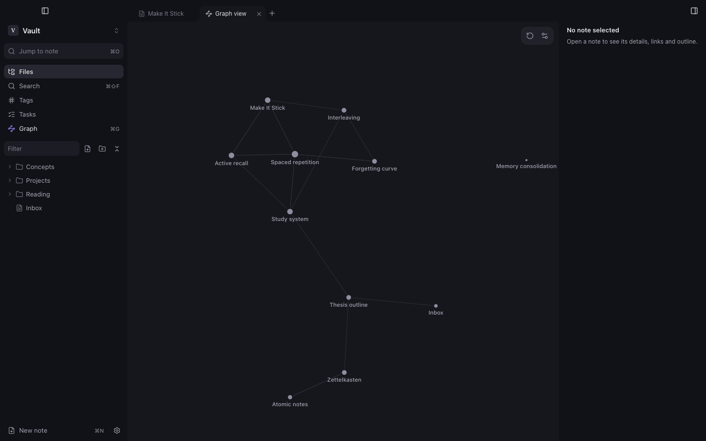

Press <kbd>⌘G</kbd> to open the graph: every note is a node and every link an edge. The active note is marked in the accent colour.

- Drag nodes, scroll to zoom, click a node to open its note.
- **Restart layout** recomputes the positions.
- From 1.3.1 (not released yet): filter the graph from its settings panel with the search syntax (`path:`, `tag:`, `file:` and plain words), show only unlinked notes, ⇧-click a node to highlight its connections (<kbd>Esc</kbd> clears), and use **Reset view**. Saved graph views are not available.

## Graph settings

Graph settings are stored per vault:

| Setting | Effect |
|---|---|
| Show orphans | include notes with no links |
| Show unresolved links | include links to notes that do not exist yet |
| Link distance | preferred length of edges |
| Repel force | how strongly nodes push each other apart |

The graph can be turned off in [Core plugins](/docs/configuration/settings/#core-plugins).
