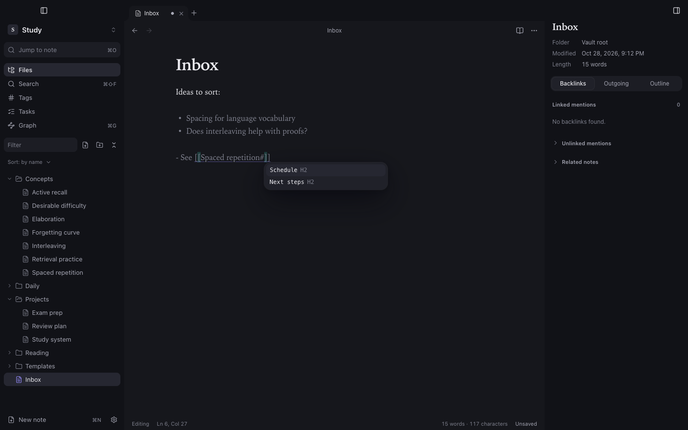

## Writing links

| Syntax | Meaning |
|---|---|
| `[[Note]]` | Link to a note |
| `[[Note#Heading]]` | Link to a heading in a note |
| `[[Note\|shown text]]` | Link with different text |
| `![[image.png]]` | Embed an image |
| `![[Note]]` | Embed another note (one level deep) |
| `[text](Folder/Note.md)` | Standard Markdown link to a vault file |

Links resolve case-insensitively. When two notes share a name, the shortest path wins, and a note in the same folder as the linking note is preferred.

## Linking to a heading (from 1.5.0)

Type `[[Note#` and the suggestions list that note's headings; `[[#` lists the headings of the note you are writing. Choosing one writes `[[Note#Heading]]`. Following the link opens the note already scrolled to that heading, in the editor and in the reading view.

## Following links

- <kbd>⌘-click</kbd> a link in the editor to open it. Add <kbd>⌥</kbd> to open it in a new tab.
- From version 1.3.0, a plain click on a link rendered by Live Preview opens it too.
- In the reading view, click any link.

Following a link to a note that does not exist creates it.

## Previewing a link (from 1.5.6)

Hold <kbd>⌘</kbd> and point at an internal link, in the editor or the reading view: the linked note appears in a floating card, already scrolled to the heading or block the link names. Move onto the card to scroll it, click it to open the note, or move away to close it. Links to notes that do not exist show no card.

## Backlinks and the note context

The dock on the right shows the open note's details and three panels:

- **Backlinks**: every note that links here, with the line around the link. **Unlinked mentions** lists notes that use the title as plain text without linking it.
- **Outgoing**: links leaving this note, including **unresolved links**. Click an unresolved one to create the note.
- **Outline**: the note's headings.

## Related notes (from 1.4.0)

The **Related notes** section of the Backlinks panel (collapsed by default) suggests notes that are not linked to this one yet, scored by shared tags, notes both link to or are linked from, and shared title, heading and distinctive words. Each suggestion says why it is there.

- **Insert link at cursor** writes the `[[…]]` link only when you choose it.
- **Dismiss** hides a suggestion for this vault.

Everything is computed locally from the index in memory; nothing leaves your Mac.

## Renaming

Rename a note from its title, with **F2**, or from the file tree's context menu. With **Automatically update internal links** on (Settings → Files and links, on by default), every link pointing to the old name or location is rewritten across the vault.

## Tags

Write tags inline as `#tag` or `#tag/nested`, or in front matter under `tags:`. Tags inside code are ignored. The **Tags** view in the left dock lists every tag with its count; from 1.5.0 nested tags show as a tree (`#learning` with `memory` and `practice` under it), and a parent's count includes its children. Click a tag to search for it, children included.
