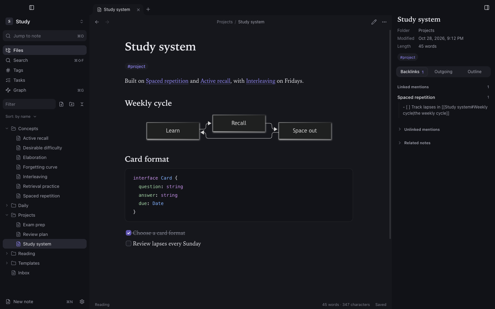
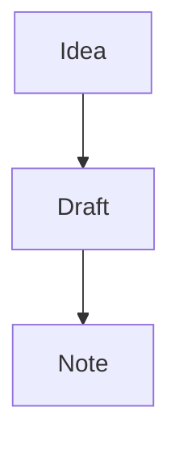

Press <kbd>⌘E</kbd> to switch a tab between editing and reading. The default view for new tabs is a setting (Settings → Editor).

The reading view renders tables, code, quotes, embeds (`![[note]]`, `![[image.png]]`), math and clickable task lists. Clicking a checkbox updates the Markdown. Front matter is shown as a properties block at the top.

## Code and diagrams

From version 1.3.0:

- Fenced code with a language (for example ` ```js `) is syntax-highlighted.
- A ` ```mermaid ` block renders as a diagram.

````md

````

## Callouts, footnotes and comments (from 1.5.6)

Notes written in Obsidian render the same way:

```md
> [!warning] Mind the step
> A callout with a title and a body.

> [!tip]- Folded until you click it
> Use `+` instead of `-` to start it open.

A claim that needs a source.[^1]

%% a comment: kept in the file, shown in the editor, hidden when reading %%

[^1]: The source.
```

Callout types such as `note`, `tip`, `success`, `question`, `warning`, `danger`, `example` and `quote` each have their own colour. Clicking a footnote number jumps to the note at the bottom, and its arrow jumps back. Exports keep callouts and footnotes and leave comments out.

## Raw HTML

HTML written inside notes is shown as text, not rendered. This is deliberate, for security: a note cannot run scripts or inject markup into the app.
