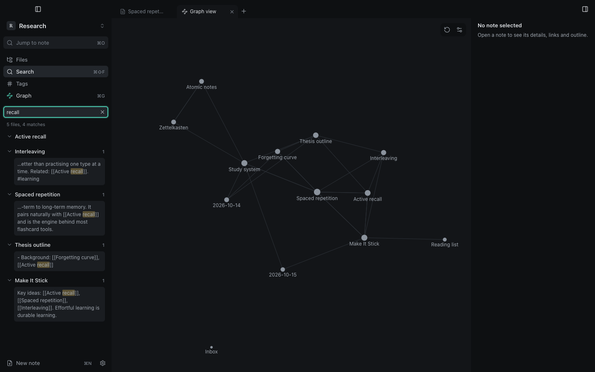

## Search

Open **Search** in the left dock or press <kbd>⇧⌘F</kbd>. Results show the matching lines with the match highlighted; click one to jump to that line.

| Query | Finds |
|---|---|
| `spaced review` | notes with both words |
| `"spaced repetition"` | the exact phrase |
| `memory -sleep` | notes with *memory* and without *sleep* |
| `tag:#learning` | notes with that tag |
| `path:Projects` | notes inside a folder |
| `file:outline` | notes whose file name matches |

## Quick switcher and command palette

- <kbd>⌘O</kbd> jumps to any note by name, with fuzzy matching.
- <kbd>⌘P</kbd> opens the command palette: every action, with its shortcut.

## Tabs and panes

- <kbd>⌘T</kbd> opens a tab, <kbd>⌘W</kbd> closes it, <kbd>⇧⌘T</kbd> reopens the last closed one.
- <kbd>⌃⇥</kbd> and <kbd>⌃⇧⇥</kbd> move between tabs; <kbd>⌥⌘←</kbd> and <kbd>⌥⌘→</kbd> go back and forward in a tab's history.
- **Split right** or **Split down** from a tab's menu, or **Open to the right** from the file tree. Panes run in one direction, up to four.

Open tabs, panes and recent notes are remembered per vault.
